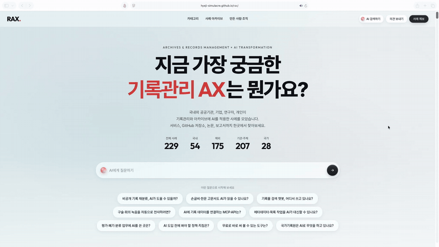

# RAX — 기록관리 AX 사례 아카이브

국내외 공공기관·기업·연구자·개인이 **기록관리와 아카이브에 AI를 적용한 사례(AX, AI Transformation)** 를 모아
카테고리별로 보여주는 정적 웹사이트입니다. 서비스, GitHub 저장소, MCP 서버·API, 논문, 보고서, 기사까지 함께 담습니다.

- 사이트: **https://hyeji-simulacre.github.io/rax/**

[](docs/media/rax-demo.mp4)

<sub>▲ 질문을 입력하면 AI가 아카이브의 사례를 근거로 답하고 [번호]로 출처를 붙입니다. 이미지를 누르면 원본 영상(MP4)이 열립니다.</sub>

영감: [PAX — 모두의 공공AX 사례 아카이브](https://hollobit.github.io/PAX/)

## 카테고리

| 카테고리 | 다루는 내용 |
|---|---|
| 분류·평가 | 자동 분류, 보존기간 부여, 평가·선별, 폐기 심사 |
| 공개·비식별 | 기록물 비공개 재분류, 비밀해제 심사, 개인정보 탐지·가림 |
| 정보공개 | 정보공개청구 처리, 원문정보공개, 사전공표, FOIA 검토 지원 |
| OCR·고문서 | 타자·필기체·한문 고문서 인식, 손글씨 인식(HTR), 기계번역 |
| 메타데이터·기술 | 메타데이터 자동 생성, 개체명 인식, 전거 연계 |
| 검색·챗봇 | 의미 검색, RAG, 기록정보서비스 챗봇, AI 에이전트 |
| 음성·영상 | 구술·회의 음성 전사, 시청각 기록 메타데이터 |
| 보존·관리 자동화 | 디지털 보존, 이관·관리 업무 자동화, 웹 아카이빙 |
| 정책·가이드 | 정책, 지침, 연구 동향, 윤리 |

형식은 `사이트·서비스`, `GitHub·오픈소스`, `MCP·API`, `논문`, `보고서`, `기사·발표` 여섯 가지입니다.

## 사례 추가하기

- **제보:** 사이트의 '사례 제보' 버튼으로 보내면 구글 시트 'RAX 사례 제보'에 쌓입니다. GitHub 이슈의 [사례 제보 양식](../../issues/new?template=case.yml)도 쓸 수 있습니다.
- **주간 업데이트:** 매주 Claude 예약 작업이 [절차서](docs/update-procedure.md)에 따라 제보와 새 사례를 정리해 PR로 올립니다. 검사를 통과한 PR은 자동으로 병합되고 사이트에 반영됩니다.
- **직접 추가:** `data/cases.json`에 항목을 넣으면 됩니다.

```json
{
  "id": "고유한 짧은 문자열",
  "title": "원제목",
  "titleKo": "한국어 제목 (원제가 외국어일 때)",
  "org": "기관·기업·개인",
  "orgType": "공공기관 | 기업 | 학계·연구 | 개인·커뮤니티",
  "region": "국내 | 해외",
  "country": "대한민국",
  "year": 2026,
  "format": "사이트·서비스 | GitHub·오픈소스 | MCP·API | 논문 | 보고서 | 기사·발표",
  "apiType": "MCP | REST API | SPARQL | IIIF (MCP·API일 때만)",
  "category": "위 여덟 카테고리 중 하나",
  "summary": "2~3문장 요약 (원문을 옮기지 말고 새로 쓰기)",
  "tags": ["태그"],
  "url": "https://…",
  "image": "선택: 대표 이미지 URL"
}
```

`image`가 없으면 카테고리 색으로 표지가 자동으로 만들어집니다. GitHub 저장소는 GitHub 미리보기 이미지를 씁니다.
형식 점검은 `python3 scripts/validate.py`로 할 수 있습니다.

## 질문과 답 (AI 채팅)

첫 화면에서 질문하면 왼쪽에 답변과 추가질문 채팅, 오른쪽에 관련 사례 목록이 나옵니다.

- **질문 제시어**를 고르면 `data/guides.json`의 큐레이션된 안내를 바로 보여 줍니다(AI 호출 없음).
- **사례 고르기**는 키워드 검색과 의미 검색을 섞습니다. 의미 검색은 배포 때 `scripts/build-embeddings.mjs`가 만든 사례 벡터(`data/embeddings.json`)와 Apps Script가 바꿔 준 질문 벡터를 비교해 뜻이 가까운 사례를 찾습니다. 실패하면 키워드 검색만 씁니다.
- **직접 쓴 질문**은 관련 사례 최대 8건을 골라 구글 Apps Script(`scripts/apps-script.gs`)로 보내고, Apps Script가 숨겨 둔 키로 OpenAI 호환 LLM API(기본 NVIDIA build.nvidia.com)를 호출합니다. 답은 그 사례만 근거로 하고 `[1]`처럼 출처 번호를 답니다.
- 키가 없거나 호출이 실패하면 가까운 안내나 검색 요약으로 대신 답합니다.
- 설정: Apps Script 프로젝트 설정 → 스크립트 속성에 `LLM_API_KEY`, `LLM_MODEL`(필요하면 `LLM_BASE_URL`, `CHAT_DAILY_MAX`)을 넣고 새 버전으로 다시 배포합니다.

## 업데이트 내용

### 2026-11-28 · 의미 검색 도입

질문과 단어가 달라도 **뜻이 비슷한 사례**를 찾아 줍니다. 예를 들어 "기록을 버릴지 남길지 AI가 판단해 줘?"라고 물으면, '평가'·'선별'이라는 단어를 쓰지 않아도 분류·평가 사례를 찾아요.

- **어떻게 찾나요:** 사례마다 뜻을 숫자 값(벡터)으로 바꿔 두고, 질문도 같은 방식으로 바꿔 둘을 비교합니다. 이렇게 찾은 결과를 기존 키워드 검색 결과와 섞어 순위를 매깁니다.
- **사례 쪽:** 사이트를 배포할 때마다 새로 들어오거나 바뀐 사례만 다시 계산합니다(`scripts/build-embeddings.mjs` → `data/embeddings.json`). NVIDIA 무료 임베딩 API를 쓰고, 지금 쓸 수 있는 모델을 공개 모델 목록에서 스스로 골라요. 지금 쓰는 모델은 `nvidia/nemotron-3.5-embed-1b`예요.
- **질문 쪽:** Apps Script의 `embed` 기능이 질문을 바꿔 줍니다. API 키는 Apps Script에만 있고 저장소에는 없습니다. 하루 호출 수는 채팅과 따로 세요(기본 2,000번).
- **화면 표시:** 답변 이름표 옆과 관련 사례 목록 위에 `의미 검색 사용 · 뜻으로 더 찾은 사례 n건` 또는 `키워드 검색만 썼어요`가 나옵니다. 키워드로는 못 찾고 뜻으로만 찾은 사례에는 `뜻으로 찾음`이 붙어요.
- **안전장치:** 의미 검색이 실패하거나 8초 넘게 걸리면 키워드 검색만으로 답해서 사이트가 멈추지 않습니다.
- **함께 고친 것:** 키워드 검색이 자주 놓치던 말을 보강했습니다. 예를 들어 '주민번호·이름 가리기'는 비식별, '시민이 요청한 공개'는 정보공개, 'AI 작업 증명'은 패러데이터 사례와 연결돼요.

실제 사이트에서 확인한 결과입니다.

| 질문 | 맨 위에 나온 사례 |
|---|---|
| 기록을 버릴지 남길지 AI가 판단해 줘? | 분류·평가 사례 (뜻으로 찾은 사례 11건) |
| 문서에서 이름이랑 주민번호 가려 주는 도구 | 판결문 개인정보 비식별화 AI |
| 시민이 요청한 자료 공개할 때 AI 쓰는 곳 | 정보공개포털 문서 수집 시스템, 일본 후생노동성 정보공개 AI |
| AI가 한 작업을 나중에 어떻게 증명해? | 호주 국립기록관 AI 투명성 성명, 패러데이터 사례 |

## 배포

`main` 브랜치에 푸시하면 GitHub Actions(`.github/workflows/pages.yml`)가 데이터를 점검한 뒤 GitHub Pages로 배포합니다.
처음 한 번은 저장소 **Settings → Pages → Build and deployment → Source**를 **GitHub Actions**로 바꿔야 합니다.

로컬에서 보려면:

```bash
python3 -m http.server 8000
# http://localhost:8000
```

## 주의

각 사례의 요약은 공개된 원문을 바탕으로 새로 쓴 글입니다. 연도나 수치는 원문 보도 기준이므로, 인용할 때는 원문을 확인해 주세요.

## 라이선스

© 2026 정혜지. 사례 데이터와 글은 [CC BY-NC 4.0](https://creativecommons.org/licenses/by-nc/4.0/deed.ko)(출처 표시, 비영리) 조건으로 이용할 수 있습니다. 자세한 내용은 [LICENSE.md](LICENSE.md)를 보세요.
